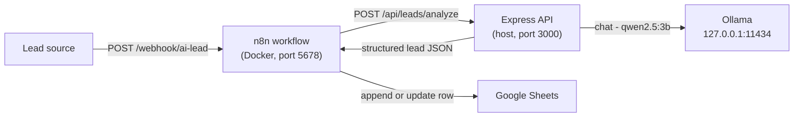

# AI Lead Tracker Automation

An AI-powered lead analysis and tracking system.

This repository contains the **Lead Analysis API**: a small **Express 5 +
TypeScript** (ESM) service that classifies inbound customer messages ("leads")
with a **local Ollama** model (`qwen2.5:3b`) and returns structured JSON. It is
built to be called by a companion **n8n** workflow running in Docker, and to be
safe by default: strictly bounded input, per-IP rate limiting, correlation IDs,
structured logging, and no secrets or stack traces exposed to clients.

The n8n side (webhook intake, priority routing, and Google Sheets tracking) is
documented separately in [`workflows/README.md`](workflows/README.md).

---

## Architecture



Request pipeline inside the Express app
([`src/app.ts`](src/app.ts)):

1. `requestContext` — resolves/echoes a request id and emits one completion log.
2. `express.json({ limit: "10kb" })` — rejects malformed or oversized bodies.
3. `apiRateLimiter` — per-IP limit on the analyze route only.
4. Route handler — Zod-validates the body, calls
   [`analyzeLead()`](src/services/lead-analyzer.ts), and maps errors to
   `502`/`504`.
5. `globalErrorHandler` — safety net returning JSON-only `4xx`/`500` responses.

---

## Prerequisites

- **Node.js 22+** — the code relies on `AbortSignal.timeout`, `AbortSignal.any`,
  `crypto.randomUUID`, `AsyncLocalStorage`, and the built-in `node:test` runner.
- **pnpm 11** — declared in [`package.json`](package.json) under
  `devEngines.packageManager` (`^11.15.0`).
- **Ollama** running locally with the model `qwen2.5:3b` pulled. The `ollama`
  client library (`0.6.x`) hard-codes its host to `http://127.0.0.1:11434` and
  ignores `OLLAMA_HOST` (see the notes below and in
  [`src/services/lead-analyzer.ts`](src/services/lead-analyzer.ts)).
- *(Optional)* **Docker / Docker Compose** — only for the companion n8n
  container ([`docker-compose.yml`](docker-compose.yml)).

---

## Setup

```bash
# 1. Install dependencies
pnpm install

# 2. Create your local environment file
cp .env.example .env
#    …then edit .env as needed (see the table below)

# 3. Start Ollama and pull the model (in a separate terminal)
ollama serve
ollama pull qwen2.5:3b

# 4. Run in watch mode
pnpm dev
```

The API then listens on `http://localhost:3000` with a health probe at
`http://localhost:3000/health`.

To also run the companion n8n workflow, start its container
(`docker compose up -d`) and follow [`workflows/README.md`](workflows/README.md).

---

## Environment variables

All variables are optional and validated at startup: an invalid value aborts
startup rather than being silently ignored. See
[`.env.example`](.env.example) for the authoritative, commented reference.

| Variable | Default | Purpose |
| --- | --- | --- |
| `PORT` | `3000` | TCP port the API listens on. |
| `LOG_LEVEL` | `info` | Pino log level: `error` \| `warn` \| `info` \| `debug`. |
| `RATE_LIMIT_WINDOW_MS` | `60000` | Length of the rate-limit window in ms. |
| `RATE_LIMIT_MAX` | `20` | Max requests per client IP per window (analyze route only). |
| `RATE_LIMIT_TRUST_PROXY` | `0` | Number of trusted reverse-proxy hops. `0` = trust disabled (secure default). Open-ended values like `true` are rejected on purpose. |
| `OLLAMA_TIMEOUT_MS` | `120000` | Max time to wait for a single Ollama completion. |
| `OLLAMA_HOST` | *(unused today)* | Documented for forward compatibility only; the current `ollama` client ignores it and hard-codes `http://127.0.0.1:11434`. |

`NODE_ENV` is read only to print the environment label on startup
([`src/server.ts`](src/server.ts)); it is not validated and does not change
behavior.

---

## Scripts

| Script | Command | Notes |
| --- | --- | --- |
| `pnpm dev` | `tsx watch src/server.ts` | Development with hot reload. |
| `pnpm build` | `tsc -p tsconfig.build.json` | Type-checks and emits ESM to `dist/` (test files excluded). |
| `pnpm start` | `node dist/server.js` | Production start. Requires `pnpm build` first. |
| `pnpm test` | `tsx --test …` | Runs the four `node:test` suites with `tsx`. |

`main` in [`package.json`](package.json) points at `dist/server.js`, matching the
build output. The project is ESM (`"type": "module"`) with
`module`/`moduleResolution` `NodeNext`, so the emitted files use `.js` import
specifiers and run directly under Node.

---

## API contract

### `GET /health`

Liveness probe. Never rate limited. Not logged at the default `info` level.

```jsonc
// 200 OK
{ "status": "ok" }
```

### `POST /api/leads/analyze`

Classifies a single customer message. Rate limited by client IP.

**Request** — `Content-Type: application/json`, body limited to 10 kb:

```jsonc
{ "message": "I need a new online store for my bakery." }
```

`message` is required, trimmed, and 1–5000 characters.

**Success** — `200 OK`:

```jsonc
{
  "success": true,
  "data": {
    "category": "ecommerce",        // "ecommerce" | "web_development" | "other"
    "intent": "new_website",        // "new_website" | "redesign" | "other"
    "priority": "high",             // "high" | "medium" | "low"
    "summary": "Customer wants a new e-commerce store."
  }
}
```

The `data` object is validated against `LeadSchema`
([`src/services/lead-analyzer.ts`](src/services/lead-analyzer.ts)); an
out-of-contract model response surfaces as a `502` rather than invalid `200`
data.

---

## Error handling

Every error response is JSON with a single `error` string (plus `details` on
validation failures). Internal details and stack traces are never returned. See
the route and global error handler in [`src/app.ts`](src/app.ts).

| Status | Body | When |
| --- | --- | --- |
| `400` | `{ "error": "Invalid request", "details": [ … ] }` | Body fails schema validation (`message` missing/empty/too long). |
| `400` | `{ "error": "Invalid request" }` | Malformed JSON rejected by the body parser. |
| `413` | `{ "error": "Invalid request" }` | Request body exceeds the parser's 10 kb limit. |
| `429` | `{ "error": "Too many requests, please try again later." }` | Client IP exceeded `RATE_LIMIT_MAX` within the window. |
| `502` | `{ "error": "Lead analysis failed" }` | Upstream Ollama/network failure (non-timeout). |
| `504` | `{ "error": "Lead analysis timed out" }` | Ollama did not respond within `OLLAMA_TIMEOUT_MS`; the upstream request is actively aborted. |
| `500` | `{ "error": "Internal server error", "requestId": "…" }` | Any other unexpected/unhandled server error. |

The API does **not** implement retries or backoff; a client (or the n8n
workflow) is responsible for any such policy.

### Request ID

Every response carries an **`X-Request-ID`** header. A valid inbound
`X-Request-ID` (ASCII `[A-Za-z0-9._-]`, ≤ 200 chars) is honored and echoed;
otherwise a UUID is generated. The same id is attached to all server logs for
that request and is included in the `500` error body for support correlation
(the header is present on every response regardless).

---

## n8n integration

The companion n8n workflow processes lead messages end to end: it exposes a
webhook, calls this API, routes leads by priority, and records them in Google
Sheets. **It is fully documented in [`workflows/README.md`](workflows/README.md).**

How the two connect:

- n8n receives leads at its webhook (`POST` to path `ai-lead`; port `5678`).
- The workflow's HTTP Request node calls this API at
  `POST http://host.docker.internal:3000/api/leads/analyze`.
- [`docker-compose.yml`](docker-compose.yml) maps `host.docker.internal` to the
  Docker host gateway on Linux (`extra_hosts`), so the container can reach the
  host. Because that route reaches the host across the Docker bridge, **the API
  must listen on all interfaces** (its default). Binding it to `127.0.0.1` only
  would make it unreachable from the container and break the workflow.

The workflow definition is authored and executed inside the running n8n
instance; the live n8n instance and the Google Sheets configuration are **not**
managed from this repository. See [`workflows/README.md`](workflows/README.md)
for the node-by-node breakdown, request/response examples, and Google Sheets
behavior.

---

## Testing

Automated tests are committed under [`src/`](src) and run with `pnpm test`
(`node:test` via `tsx`):

| Suite | Covered |
| --- | --- |
| [`src/app.test.ts`](src/app.test.ts) | Rate limiting on `POST /api/leads/analyze`; `GET /health` is never rate limited. |
| [`src/logging.test.ts`](src/logging.test.ts) | Request-ID generation/echoing and validation; one completion log per request; health checks not logged at `info`; redaction of secret-bearing keys; raw lead message never logged. |
| [`src/services/lead-analyzer.test.ts`](src/services/lead-analyzer.test.ts) | Timeout classification (`OllamaTimeoutError`) and `LeadSchema` validation. |
| [`src/timeout-cancellation.test.ts`](src/timeout-cancellation.test.ts) | A timed-out Ollama call actively cancels the in-flight upstream request (real socket abort) and the API returns `504`. |

These tests exercise the **Express API**. There is **no automated test for the
n8n workflow** in this repository: the webhook → API → Google Sheets path is
**not** covered end to end. Workflow behavior (priority routing, Google Sheets
append/update and deduplication) is **manually verified** only, and is described
as such in [`workflows/README.md`](workflows/README.md).

---

## Security & exposure notes

- The server binds to **all host interfaces** (Express's default when no host is
  given). This is required for the n8n container to reach it via
  `host.docker.internal`. Treat the API as network-exposed on the host (LAN, and
  public if the firewall allows) and restrict it with a firewall or a reverse
  proxy if the machine is not trusted.
- **There is no authentication** on either endpoint. Anyone who can reach the
  port can submit lead messages.
- `RATE_LIMIT_TRUST_PROXY` must stay at `0` unless the service sits behind an
  exact, known number of proxies; otherwise a client can spoof
  `X-Forwarded-For` and bypass the rate limit.
- **DoS surface:** each analyze request invokes a local LLM. The route is rate
  limited per IP, but rate limiting is not a substitute for access control.
- **PII:** lead messages are customer content and may contain personal data;
  protect Google Sheets access accordingly.
- **Logs:** the API never logs request bodies or raw messages and redacts common
  secret-bearing keys defensively ([`src/lib/logger.ts`](src/lib/logger.ts)).
- **Prompt injection:** the analyzer instructs the model to treat the customer
  message as data, not instructions, and requests JSON-only output, but model
  output is not a trusted security boundary.
- **Private workflow export:** the repository's [`.gitignore`](.gitignore)
  excludes `.env` files and private n8n workflow-export patterns
  (`*.json.bak`, `workflows/*.fixed.json`, `workflows/*private*.json`). Any
  workflow export must be sanitised before it is committed or shared.

---

## Known limitations

Current, verified behavior — not a wish list:

- **No authentication** on the API or the workflow webhook; access control is
  left to the network/firewall.
- **No retry/backoff** anywhere in the API. The n8n workflow's HTTP Request node
  also has **no retry configuration**; it merely routes errors to a `500`
  responder.
- The n8n workflow collapses every non-success API outcome (`400`/`413`/`429`/
  `502`/`504`) into a generic `500`, so the real upstream status is not surfaced
  to the caller (documented in [`workflows/README.md`](workflows/README.md)).
- **No automated end-to-end test** for the n8n workflow; Google Sheets
  deduplication is a normalized-message heuristic verified only manually.
- `OLLAMA_HOST` is documented but **not honored** by the current client library,
  which hard-codes `http://127.0.0.1:11434`.

## Possible future improvements

Suggestions only — none of these are implemented in this repository:

- Add authentication (e.g. a shared secret header) to the API and the webhook.
- Add retry/backoff for transient upstream failures and map API statuses to
  distinct webhook responses.
- Add an automated end-to-end test for the n8n workflow and a sanitisation step
  for exported workflow JSON.
