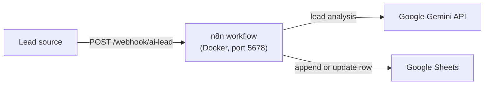

# AI Lead Tracker Automation

Lead intake, AI analysis, and tracking run in **n8n**. This repository contains
the companion **Express 5 + TypeScript (ESM)** backend.

Lead analysis was **moved into the n8n workflow (Google Gemini)**, so the backend
**no longer performs any AI work**: it no longer calls Gemini or Ollama and does
not expose a lead-analysis endpoint. What remains is a small, safe **health-only**
HTTP service that keeps the shared request pipeline (request correlation,
structured logging, body-parser hardening, and JSON-only error handling).

The n8n side (webhook intake, Gemini analysis, priority routing, and Google
Sheets tracking) is documented in [`workflows/README.md`](workflows/README.md).

---

## Architecture

End-to-end flow — **webhook → Gemini in n8n → Google Sheets**:



Responsibilities are split as follows:

| Component | Responsibility |
| --- | --- |
| **n8n** | Webhook intake, AI analysis with **Gemini**, validation/branching (e.g. by priority), and Google Sheets operations. |
| **Express backend** (this repo) | A health probe (`GET /health`) plus generic HTTP hardening: request-id correlation, structured logging, body-parser limits, and a JSON-only error handler. **No AI provider calls.** |

The backend is **not** in the lead path: n8n no longer calls it for analysis.

Request pipeline inside the Express app ([`src/app.ts`](src/app.ts)):

1. `requestContext` — resolves/echoes a request id and emits one completion log.
2. `express.json({ limit: "10kb" })` — rejects malformed or oversized bodies.
3. Route handler — `GET /health`.
4. `globalErrorHandler` — safety net returning JSON-only `4xx`/`500` responses.

---

## Prerequisites

- **Node.js 22+** — the code relies on `crypto.randomUUID`, `AsyncLocalStorage`,
  and the built-in `node:test` runner.
- **pnpm 11** — declared in [`package.json`](package.json) under
  `devEngines.packageManager` (`^11.15.0`).
- *(Optional)* **Docker / Docker Compose** — only for the companion n8n
  container ([`docker-compose.yml`](docker-compose.yml)).
- *(Optional)* **n8n with a Google Gemini credential** — the AI analysis runs
  there, not in this backend.

---

## Setup

```bash
# 1. Install dependencies
pnpm install

# 2. Create your local environment file (all variables are optional)
cp .env.example .env

# 3. Run in watch mode
pnpm dev
```

The API then listens on `http://localhost:3000` with a health probe at
`http://localhost:3000/health`.

To also run the companion n8n workflow, start its container
(`docker compose up -d`) and follow [`workflows/README.md`](workflows/README.md).

---

## Environment variables

All variables are optional and validated at startup: an invalid value aborts
startup rather than being silently ignored. See
[`.env.example`](.env.example) for the authoritative, commented reference.

| Variable | Default | Purpose |
| --- | --- | --- |
| `PORT` | `3000` | TCP port the API listens on. |
| `LOG_LEVEL` | `info` | Pino log level: `error` \| `warn` \| `info` \| `debug`. |

`NODE_ENV` is read only to print the environment label on startup
([`src/server.ts`](src/server.ts)); it is not validated and does not change
behavior.

AI-provider, Ollama, and rate-limit variables (`AI_PROVIDER`, `GEMINI_API_KEY`,
`GEMINI_MODEL`, `AI_TIMEOUT_MS`, `OLLAMA_TIMEOUT_MS`, `OLLAMA_HOST`,
`RATE_LIMIT_*`) are **no longer read** by this service and have been removed from
the configuration template.

---

## Scripts

| Script | Command | Notes |
| --- | --- | --- |
| `pnpm dev` | `tsx watch src/server.ts` | Development with hot reload. |
| `pnpm build` | `tsc -p tsconfig.build.json` | Type-checks and emits ESM to `dist/` (test files excluded). |
| `pnpm start` | `node dist/server.js` | Production start. Requires `pnpm build` first. |
| `pnpm test` | `tsx --test …` | Runs the `node:test` suites with `tsx`. |

`main` in [`package.json`](package.json) points at `dist/server.js`, matching the
build output. The project is ESM (`"type": "module"`) with
`module`/`moduleResolution` `NodeNext`, so the emitted files use `.js` import
specifiers and run directly under Node.

---

## API contract

### `GET /health`

Liveness probe. Never rate limited. Not logged at the default `info` level.

```jsonc
// 200 OK
{ "status": "ok" }
```

The previously exposed `POST /api/leads/analyze` endpoint has been **removed**;
it now returns `404`. Lead analysis is performed by the n8n workflow instead.

---

## Error handling

Errors handled by the app's pipeline return JSON with a single `error` string;
internal details and stack traces are never returned. Requests to unknown routes
(including the removed analyze endpoint) fall through to Express's default `404`
response. See [`src/app.ts`](src/app.ts).

| Status | Body | When |
| --- | --- | --- |
| `400` | `{ "error": "Invalid request" }` | Malformed JSON or a body above the parser's 10 kb limit. |
| `404` | *(Express default)* | Unknown route (including the removed analyze endpoint). |
| `500` | `{ "error": "Internal server error", "requestId": "…" }` | Any other unexpected/unhandled server error. |

### Request ID

Every response carries an **`X-Request-ID`** header. A valid inbound
`X-Request-ID` (ASCII `[A-Za-z0-9._-]`, ≤ 200 chars) is honored and echoed;
otherwise a UUID is generated. The same id is attached to all server logs for
that request and is included in the `500` error body for support correlation
(the header is present on every response regardless).

---

## n8n integration

The companion n8n workflow owns the lead pipeline end to end: it exposes a
webhook, performs the **Gemini** analysis, routes leads (e.g. by priority), and
records them in Google Sheets. **It is documented in
[`workflows/README.md`](workflows/README.md).**

The workflow definition is authored and executed inside the running n8n
instance; the live n8n instance and the Google Sheets configuration are **not**
managed from this repository.

---

## Testing

Automated tests are committed under [`src/`](src) and run with `pnpm test`
(`node:test` via `tsx`):

| Suite | Covered |
| --- | --- |
| [`src/app.test.ts`](src/app.test.ts) | `GET /health` returns `200 { status: "ok" }` and is unrestricted; the removed AI endpoint returns `404`; unknown routes return `404`. |
| [`src/logging.test.ts`](src/logging.test.ts) | Request-ID generation/echoing and validation; one completion log per request; health checks not logged at `info`; redaction of secret-bearing keys. |

These tests exercise the **Express API**. There is **no automated test for the
n8n workflow** in this repository: the webhook → Gemini → Google Sheets path is
**not** covered end to end.

---

## Deployment (Render)

- **Start command:** `node dist/server.js` (unchanged). Build with
  `pnpm build` first so `dist/` exists.
- **Port:** from the `PORT` environment variable (default `3000`), bound to all
  interfaces — unchanged.
- **Health check:** point the platform's health check at `GET /health`.
- **Environment:** only `PORT` (usually provided by the platform) and
  `LOG_LEVEL` are relevant. There are no AI provider secrets to configure,
  because the backend no longer calls any provider.

---

## Security & exposure notes

- The server binds to **all host interfaces** (Express's default when no host is
  given). Restrict it with a firewall or a reverse proxy if the machine is not
  trusted.
- **There is no authentication.** The only route is a liveness probe, which
  exposes no data.
- **No AI provider secrets** are stored or read by this service.
- **Logs:** the API never logs request bodies and redacts common secret-bearing
  keys defensively ([`src/lib/logger.ts`](src/lib/logger.ts)).
- **Private workflow export:** the repository's [`.gitignore`](.gitignore)
  excludes `.env` files and private n8n workflow-export patterns
  (`*.json.bak`, `workflows/*.fixed.json`, `workflows/*private*.json`). Any
  workflow export must be sanitised before it is committed or shared.

---

## Known limitations

Current, verified behavior — not a wish list:

- **No authentication** on the API; access control is left to the
  network/firewall.
- The backend's only route is `/health`; all lead-related behavior lives in n8n
  and is not covered by automated tests in this repository.

## Possible future improvements

Suggestions only — none of these are implemented in this repository:

- Add authentication if any data-bearing endpoint is reintroduced.
- Add an automated end-to-end test for the n8n workflow and a sanitisation step
  for exported workflow JSON.
