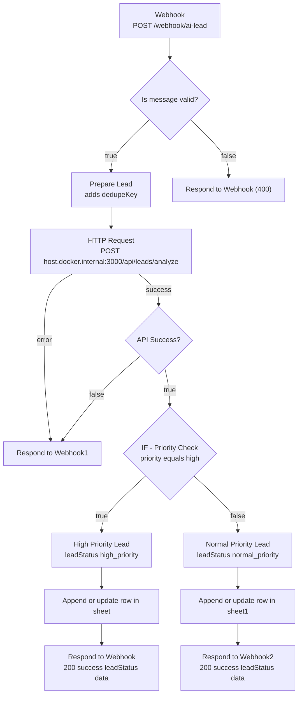

# n8n Workflow — AI Lead Tracker

This directory documents the **n8n** component of the AI lead-analysis and
tracking system. The Node/TypeScript **Lead Analysis API** (the Express app in
[`../src`](../src)) classifies an inbound customer message with a local Ollama
model; an n8n workflow receives the message, calls that API, routes the lead by
priority, and records it in Google Sheets.

> [!IMPORTANT]
> The **running n8n instance is the source of truth.** The workflow is authored
> and executed inside n8n (launched from [`../docker-compose.yml`](../docker-compose.yml)),
> not from this directory. Any JSON kept here is a **read-only export/backup**,
> not the deployed definition.

> [!WARNING]
> **This directory currently contains a private, instance-specific workflow
> export** ([`ai-lead-tracker.fixed.json`](ai-lead-tracker.fixed.json)) that has
> **not** been sanitised. It embeds a Google Sheets spreadsheet URL/ID, an n8n
> OAuth credential reference, the workflow id, and an instance id. See
> [Security and privacy](#security-and-privacy) before committing or sharing it.
> Those concrete values are intentionally **not** reproduced in this document.

---

## Workflow architecture

The structure below reflects the exported workflow in
[`ai-lead-tracker.fixed.json`](ai-lead-tracker.fixed.json). Webhook **paths**,
**ifs**, and node names are quoted verbatim from that export.



`Respond to Webhook1` is reached from **two** inputs (the HTTP Request error
output and the *API Success?* `false` output) and always replies with HTTP `500`.

---

## Workflow steps

| Node (exact name) | Type | Responsibility |
| --- | --- | --- |
| `Webhook` | Webhook | Entry point. `POST` to path `ai-lead`; `responseMode` is `responseNode`, so a **Respond to Webhook** node must run for the caller to get a response. |
| `Is message valid?` | IF | Boolean gate: continues only when the webhook body is a non-null, non-array object whose `message` is a string with non-empty trimmed length. On failure routes to the `400` responder. |
| `Prepare Lead` | Set | Adds `dedupeKey` = `message.trim().toLowerCase()`. Used later as the Google Sheets match column. |
| `HTTP Request` | HTTP Request | `POST` to `http://host.docker.internal:3000/api/leads/analyze` with JSON body `{ "message": "<from Webhook>" }`. Node timeout is `110000` ms and `onError` is `continueErrorOutput`. |
| `API Success?` | IF | Boolean gate on `success === true` in the API response. |
| `IF — Priority Check` | IF | Strict string equality on `data.priority == "high"`. |
| `High Priority Lead` | Set | Sets `leadStatus: "high_priority"` and `action: "contact_immediately"`, plus `priority`/`summary` from the API result. |
| `Normal Priority Lead` | Set | Sets `leadStatus: "normal_priority"` and `action: "review_later"`, plus `priority`/`summary`. |
| `Append or update row in sheet` | Google Sheets | Writes the high-priority row (`appendOrUpdate`). |
| `Append or update row in sheet1` | Google Sheets | Writes the normal-priority row (`appendOrUpdate`). |
| `Respond to Webhook` / `Respond to Webhook2` | Respond to Webhook | `200` with `{ success: true, leadStatus, data }`. |
| `Respond to Webhook (400)` | Respond to Webhook | `400` with `{ error: "Invalid request", details: "message is required and must be a non-empty string" }`. |
| `Respond to Webhook1` | Respond to Webhook | `500` with `{ error: "Lead analysis failed" }`. |

**Branch note:** the workflow splits high vs. everything-else. A `medium` or
`low` priority lead therefore falls through to the *normal* branch and is written
by `Append or update row in sheet1`.

---

## Local prerequisites

| Requirement | Notes |
| --- | --- |
| Node.js 22+ | Required by the API (see [`../README.md`](../README.md)). |
| pnpm 11 | The API's package manager (`devEngines` in [`../package.json`](../package.json)). |
| Ollama + `qwen2.5:3b` | The API's model (`ollama serve`, then `ollama pull qwen2.5:3b`). |
| Docker / Docker Compose | For the n8n container. |
| n8n (via Docker) | Started from [`../docker-compose.yml`](../docker-compose.yml); UI/port `5678`. |
| Google Sheets OAuth2 credential | Attached inside n8n (**not** stored in this repo). |

---

## Setup

The API and n8n run as separate processes/containers.

### 1. Start the API (host)

```bash
pnpm install
pnpm dev
```

The API listens on `http://localhost:3000` by default (configurable via `PORT`).
It binds to **all host interfaces** so the n8n container can reach it — see
[Networking](#how-n8n-reaches-the-express-api-inside-docker).

### 2. Start n8n (Docker)

```bash
docker compose up -d
```

The service publishes `5678:5678` and maps `host.docker.internal` to the host
gateway. Start n8n **after** the API so the first calls succeed.

### 3. Import / configure the workflow in n8n

1. Open the n8n UI (e.g. `http://localhost:5678`) and import the workflow JSON.
2. Re-attach the **Google Sheets OAuth2** credential (exports omit secret values
   but keep a credential *reference*).
3. Confirm the Google Sheets `documentId` and worksheet point at **your** target
   spreadsheet.
4. **Activate** the workflow — the current export is `active: false`, so nothing
   runs until it is activated.

### 4. First run

The Webhook node uses **`responseMode: responseNode`**, so when the workflow is
imported but *not activated*, you can reach the webhook at the **test** URL of
the Webhook node. Click **Listen for test event** (or *Execute workflow*) and
POST to the test URL, or activate the workflow and POST to the production path.

### Google Sheets prerequisites

The target spreadsheet must already contain a **header row** with these exact
column names (case-sensitive), because the Sheets nodes map fields by name and
match rows on `dedupekey`:

`createdAt`, `message`, `category`, `intent`, `priority`, `leadStatus`,
`summary`, `dedupekey`

If a column is missing, n8n either appends it to the sheet or fails, depending
on the node's settings.

---

## How n8n reaches the Express API inside Docker

The n8n container talks to the API running on the **host**. The HTTP Request node
must use `host.docker.internal`, **not** `localhost`/`127.0.0.1` (inside the
container those resolve to the container itself):

```text
# reachable from inside the container (used by the workflow)
http://host.docker.internal:3000/api/leads/analyze

# NOT reachable from inside the container
http://localhost:3000/api/leads/analyze
http://127.0.0.1:3000/api/leads/analyze
```

This works because [`../docker-compose.yml`](../docker-compose.yml) maps the name
to the host gateway on Linux:

```yaml
extra_hosts:
  # Makes host.docker.internal resolve to the host machine on Linux
  - "host.docker.internal:host-gateway"
```

Because that route originates from outside the host loopback interface, the API
must keep listening on all interfaces (its default; see
[`../src/server.ts`](../src/server.ts)). Binding it to `127.0.0.1` only would
make it unreachable and break the workflow.

---

## Webhook endpoint and request example

The webhook is an n8n webhook (`POST`, path `ai-lead`), **not** the Express API
endpoint. Once the workflow is activated, n8n exposes it at:

```text
POST http://<n8n-host>:5678/webhook/ai-lead
Content-Type: application/json
```

(While editing, the node's **test** URL is used instead of `/webhook/`.)

Request body — a single non-empty `message` string:

```bash
curl -X POST http://localhost:5678/webhook/ai-lead \
  -H "Content-Type: application/json" \
  -d '{"message":"I need a new online store for my bakery."}'
```

`message` must be a non-empty string after trimming, otherwise the workflow
short-circuits to the `400` responder. There is **no length cap in n8n**; the
Express API enforces a 5000-character limit (see
[API response mapping](#api-response-mapping)).

---

## Response examples

Responses are returned by the workflow's **Respond to Webhook** nodes (not by
the Express API directly). The `data` object is the API's `data` passed through
unchanged; `leadStatus` is added by the priority branch. Values below are
illustrative.

**Success — HTTP `200`** (from `Respond to Webhook` / `Respond to Webhook2`):

```jsonc
{
  "success": true,
  "leadStatus": "high_priority",   // "high_priority" | "normal_priority"
  "data": {
    "category": "ecommerce",       // "ecommerce" | "web_development" | "other"
    "intent": "new_website",       // "new_website" | "redesign" | "other"
    "priority": "high",            // "high" | "medium" | "low"
    "summary": "Customer wants a new e-commerce store."
  }
}
```

**Invalid input — HTTP `400`** (from `Respond to Webhook (400)`):

```jsonc
{
  "error": "Invalid request",
  "details": "message is required and must be a non-empty string"
}
```

**Failure — HTTP `500`** (from `Respond to Webhook1`, reached on a non-`2xx`
API response or the HTTP Request node's error output):

```jsonc
{ "error": "Lead analysis failed" }
```

> [!NOTE]
> The workflow's HTTP Request node only distinguishes *success* (`success ===
> true`) from *failure*. It collapses every non-success API outcome — `400`,
> `413`, `429`, `502`, `504` — into the single `500` body above; the original API
> status/error is **not** forwarded to the caller.

### API response mapping

| API result | `success` | Workflow outcome |
| --- | --- | --- |
| `200` with a valid lead body (`success: true`) | `true` | → *API Success?* `true` → priority branch → Sheets → `200`. |
| `400` malformed JSON / missing or empty `message` | `undefined` | → *API Success?* `false` → `Respond to Webhook1` (`500`). |
| `413` body > 10 kb | `undefined` | → `500`. |
| `429` rate limited | `undefined` | → `500`. |
| `502` upstream failure | `undefined` | → `500`. |
| `504` Ollama timeout | `undefined` | → `500`. |

There is **no automatic retry configuration** on the HTTP Request node in the
export; it uses `onError: continueErrorOutput` and a `110000` ms (~110 s) node
timeout (below the API's default `OLLAMA_TIMEOUT_MS` of 120000).

---

## Google Sheets configuration and deduplication

**Columns written** (exact header names, matching the node field names):

| Column | Source |
| --- | --- |
| `createdAt` | `{{ $now.toISO() }}` — current time as an ISO 8601 string, evaluated when the row is written. |
| `message` | The original webhook `body.message`. |
| `category` | `data.category` from the API response. |
| `intent` | `data.intent` from the API response. |
| `priority` | `data.priority` (via the branch Set node). |
| `leadStatus` | `high_priority` or `normal_priority`. |
| `summary` | `data.summary` from the API response. |
| `dedupekey` | `message.trim().toLowerCase()` (from `Prepare Lead`). |

**Deduplication / upsert behaviour**

- Both Sheets nodes use `operation: appendOrUpdate` with `matchingColumns:
  ["dedupekey"]`.
- The dedupe key is the normalized message (`trim` + `toLowerCase`). Two leads
  with the same normalized message are treated as the **same row** and updated
  in place rather than appended — so re-submitting an identical message does not
  create a duplicate row.
- Because the key is normalisation-based, messages that differ only in case or
  surrounding whitespace collide (the second overwrites/updates the first).
- `createdAt` is `$now` at write time, so an updated (matched) row gets a **new**
  timestamp reflecting the latest submission, not the original creation time.
- Both branches write to the **same** target spreadsheet/worksheet in the
  current configuration; the match column keeps the behaviour idempotent.

> [!NOTE]
> The Google Sheets spreadsheet/worksheet identifiers, and the OAuth2 credential
> name/id, are present in the export but deliberately omitted here.

---

## Testing and verification status

Be precise about what is actually proven, and by what.

**Verified by reading the implementation (this repository):**

- Workflow structure, node names, node types, the `POST ai-lead` webhook with
  `responseMode: responseNode`, the HTTP Request URL/body/timeout, the priority
  condition (`data.priority == "high"`), the Sheets columns and match column,
  and the `400`/`500` responder bodies — all cross-checked against
  [`ai-lead-tracker.fixed.json`](ai-lead-tracker.fixed.json).
- The Express API contract ([`../src/app.ts`](../src/app.ts),
  [`../src/services/lead-analyzer.ts`](../src/services/lead-analyzer.ts)) that
  the workflow consumes.
- That the export is `active: false` and contains an **unsanitised**
  instance-specific credential reference and spreadsheet URL.

**Verified by automated tests (committed in [`../src`](../src), run with `pnpm test`):**

- Rate limiting on `POST /api/leads/analyze` and that `GET /health` is never
  rate limited ([`../src/app.test.ts`](../src/app.test.ts)).
- Request-ID generation/echoing, one completion log per request, health checks
  not logged at `info`, redaction of secret-bearing keys, and that the raw lead
  message is **never** logged ([`../src/logging.test.ts`](../src/logging.test.ts)).
- Timeout classification and `LeadSchema` validation
  ([`../src/services/lead-analyzer.test.ts`](../src/services/lead-analyzer.test.ts)).
- That a timed-out Ollama call actively **cancels** the in-flight upstream
  request (real socket abort) and returns `504`
  ([`../src/timeout-cancellation.test.ts`](../src/timeout-cancellation.test.ts)).

**Not covered by automated tests (manual/unverified):**

- There is **no automated test for the n8n workflow itself** (no end-to-end
  webhook → API → Sheets coverage in this repository).
- Google Sheets append/update and deduplication were **manually tested** in the
  live instance; the exact current dedupe/overwrite results are **unverified**
  here.
- Whether a sanitised re-import of the export into a scratch n8n instance
  succeeds is **unverified**.

---

## Security and privacy

- **Instance-specific data in the export (present, not sanitised):**
  [`ai-lead-tracker.fixed.json`](ai-lead-tracker.fixed.json) contains a Google
  Sheets spreadsheet URL/ID, a Google Sheets OAuth2 credential reference
  (credential id + account name), the n8n `webhookId`, the workflow `id`, and a
  `meta.instanceId`. The concrete values are **not** reproduced in this document.
  Treat the file as private and sanitise it before committing or publishing.
- **The API has no authentication.** Anyone who can reach the port can submit
  lead messages. The existing design relies on network-level access control
  (firewall / reverse proxy). See [`../README.md`](../README.md) → *Security &
  exposure notes*.
- **DoS surface:** `POST /api/leads/analyze` invokes a local LLM per request.
  A public webhook that triggers it (directly via the API, or via this workflow)
  can be abused for resource exhaustion. n8n itself uses an execution timeout
  (`EXECUTIONS_TIMEOUT=120`, `EXECUTIONS_TIMEOUT_MAX=300` in
  [`../docker-compose.yml`](../docker-compose.yml)), and the API applies per-IP
  rate limiting, but neither is a substitute for access control.
- **PII in Google Sheets:** lead messages are customer content and may contain
  personal data. Protect spreadsheet access accordingly.
- **Logs:** the API never logs request bodies or raw messages, and redacts
  secret-bearing keys defensively ([`../src/lib/logger.ts`](../src/lib/logger.ts)).
- **Prompt injection:** the analyzer instructs the model to treat the customer
  message as data, not instructions, and requests JSON-only output, but model
  output is not a trusted security boundary.

---

## Known limitations and future improvements

**Known limitations (current behaviour):**

- The workflow returns `500` for **every** non-success API outcome and does not
  surface the real API status (`400`/`413`/`429`/`502`/`504`) to the caller.
- **No retry/backoff** is configured on the HTTP Request node, despite the API
  being able to return transient `429`/`502`/`504` responses.
- There is **no validation-failure path back to the caller** for oversized
  `message` values: n8n allows any length, and the API's `413` is collapsed into
  the generic `500`.
- `dedupeKey` is a normalised-message heuristic; it cannot distinguish genuinely
  different leads that share the same normalized text, and `createdAt` is
  overwritten on every matched update.
- The n8n **execution timeout** (`120` s) is only marginally above the HTTP node
  timeout (`110` s) and equal to the API's default Ollama timeout (`120` s), so a
  single slow inference can approach or exceed the execution budget.

**Possible improvements (not implemented here):**

- Retry transient failures with backoff (e.g. n8n's *Retry On Fail*) and map API
  statuses to distinct webhook responses.
- Add authentication (e.g. a shared secret/header) to the webhook and/or the API.
- Add an automated end-to-end test for the workflow and a sanitisation step for
  exported JSON.

> These are suggestions, not descriptions of current behaviour.

---

## Exporting and sanitising the workflow JSON

Credentials are stored **separately** in n8n, so an export contains credential
*references* (id/name), not secret values — but node parameters and metadata can
still carry instance-specific or sensitive data. **Export → sanitise → commit.**

### Option A — Download from the UI

1. Open the workflow in n8n.
2. Workflow menu (**⋯**) → **Download** (“Download workflow”).
3. Move the file into this repo, then sanitise it.

### Option B — CLI export from the container

```bash
# Find the n8n container
docker ps --filter ancestor=docker.n8n.io/n8nio/n8n

# Export one workflow by id (--all exports every workflow)
docker exec -it <n8n-container> \
  n8n export:workflow --id=<workflow-id> --output=/tmp/ai-lead-tracker.json

# Copy the file out of the container into this repo
docker cp <n8n-container>:/tmp/ai-lead-tracker.json ./workflows/ai-lead-tracker.json
```

### Option C — REST API

```bash
curl -sS \
  -H "X-N8N-API-KEY: $N8N_API_KEY" \
  "$N8N_BASE_URL/api/v1/workflows/<workflow-id>" \
  -o ./workflows/ai-lead-tracker.json
```

### Before committing

- [ ] Remove node `credentials` objects (instance-specific credential
      references); re-attach them in n8n after import.
- [ ] Replace the webhook `path`/`webhookId` with placeholders.
- [ ] Replace the Google Sheets `documentId` and any `cachedResultUrl` with a
      placeholder such as `"<SPREADSHEET_ID>"`.
- [ ] Keep the generic `http://host.docker.internal:3000/...` URL, but remove any
      baked-in tokens, API keys, or `Authorization` headers.
- [ ] Scan Code/Set nodes for hard-coded secrets, emails, or internal hostnames.
- [ ] Delete `pinData` (may hold real lead content / PII).
- [ ] Consider removing `id`, `versionId`, `meta.instanceId`, `createdAt`,
      `updatedAt` (instance-specific; a new `id` is assigned on import).
- [ ] Verify with a scan, e.g.
      `grep -iE '(api[_-]?key|token|secret|password|authorization|bearer)' workflows/ai-lead-tracker.json`
      and confirm the file still parses:
      `node -e "JSON.parse(require('fs').readFileSync('workflows/ai-lead-tracker.json','utf8'))"`.

**Never commit:** the real `.env`, `~/.n8n/config`, `N8N_ENCRYPTION_KEY`, or the
`n8n_data` volume contents. The repo [`.gitignore`](../.gitignore) already
excludes `.env` files and several private workflow-export patterns.
