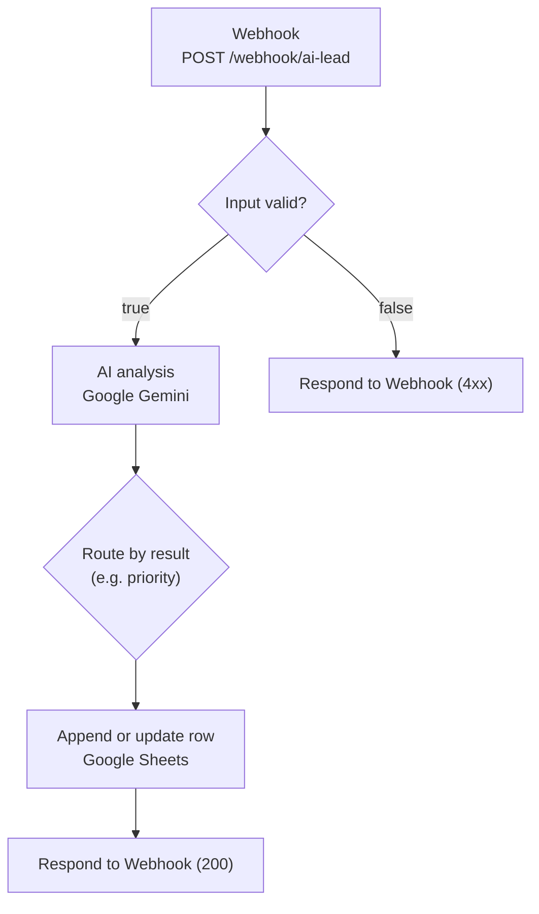

# n8n Workflow — AI Lead Tracker

This directory documents the **n8n** component of the AI lead-analysis and
tracking system. The n8n workflow owns the lead pipeline end to end:

**Webhook → Gemini (AI analysis) → branch → Google Sheets**

AI analysis runs **inside n8n** using **Google Gemini**. The companion
Node/TypeScript **Express backend** in [`../src`](../src) no longer performs any
AI work (it no longer calls Gemini or Ollama) and is **not** called by the
workflow; it now serves only a health endpoint. See
[`../README.md`](../README.md).

> [!IMPORTANT]
> The **running n8n instance is the source of truth.** The workflow is authored
> and executed inside n8n (launched from [`../docker-compose.yml`](../docker-compose.yml)),
> not from this directory. Any JSON kept here is a **read-only export/backup**,
> not the deployed definition.
>
> Node-level details (exact node names, branching conditions, and the response
> the webhook returns) live in the running instance. They are **not reproduced
> here**: the workflow was reconfigured to perform the AI analysis internally,
> and its current definition has not been re-inspected and published into this
> repository.

> [!WARNING]
> **A private, instance-specific workflow export exists but is not published.**
> Any exported workflow JSON kept in this directory has **not** been sanitised
> and embeds credential references and spreadsheet identifiers. It is
> intentionally excluded from version control (see
> [`../.gitignore`](../.gitignore)) and is **not** linked or reproduced here. See
> [Security and privacy](#security-and-privacy) before committing, sharing, or
> re-exporting it.

---

## Workflow architecture



The labels above describe responsibilities; the concrete node names and
conditions are defined in the running n8n instance (see the note above).

---

## Responsibilities

| Concern | Owner |
| --- | --- |
| Webhook intake and request validation | n8n |
| AI lead analysis (classification, summary, priority) | n8n — **Google Gemini** |
| Branching / routing (e.g. by priority) | n8n |
| Google Sheets append/update | n8n |
| Health probe and generic HTTP hardening | Express backend ([`../src`](../src)) |

The Express backend is **not** part of the lead path.

---

## Local prerequisites

| Requirement | Notes |
| --- | --- |
| Docker / Docker Compose | For the n8n container. |
| n8n (via Docker) | Started from [`../docker-compose.yml`](../docker-compose.yml); UI/port `5678`. |
| Google Gemini credential | Attached inside n8n (**not** stored in this repo). |
| Google Sheets OAuth2 credential | Attached inside n8n (**not** stored in this repo). |

---

## Setup

### 1. Start n8n (Docker)

```bash
docker compose up -d
```

The service publishes `5678:5678`.

### 2. Configure the workflow in n8n

1. Open the n8n UI (e.g. `http://localhost:5678`).
2. Open (or import) the workflow.
3. Re-attach the **Google Gemini** and **Google Sheets OAuth2** credentials.
4. Confirm the Google Sheets document and worksheet point at **your** target
   spreadsheet.
5. **Activate** the workflow so the production webhook path is live.

### 3. First run

The Webhook node uses **`responseMode: responseNode`**, so a **Respond to
Webhook** node must run for a caller to receive a response. While the workflow is
imported but *not activated*, use the Webhook node's **test** URL; once
activated, POST to the production path below.

---

## Webhook endpoint and request example

The webhook is an n8n webhook (`POST`, path `ai-lead`):

```text
POST http://<n8n-host>:5678/webhook/ai-lead
Content-Type: application/json
```

Request body — a single non-empty `message` string:

```bash
curl -X POST http://localhost:5678/webhook/ai-lead \
  -H "Content-Type: application/json" \
  -d '{"message":"I need a new online store for my bakery."}'
```

Invalid input (for example a missing/empty `message`) is short-circuited by the
workflow's validation step to a `4xx` responder.

---

## Google Sheets

The workflow records each lead in Google Sheets. The exact column names, the
match/upsert column, and the deduplication behaviour are defined by the Sheets
nodes in the running instance and should be confirmed there before relying on
them.

> [!NOTE]
> The Google Sheets spreadsheet/worksheet identifiers, and the OAuth2 credential
> name/id, are present in any export but deliberately omitted here.

---

## Security and privacy

- **Instance-specific data in exports (present, not sanitised):** a private
  workflow export can contain a Google Sheets spreadsheet URL/ID, a Google
  Sheets OAuth2 credential reference (credential id + account name), the n8n
  `webhookId`, the workflow `id`, and a `meta.instanceId`. Such a file is **not**
  published (see [`../.gitignore`](../.gitignore)); concrete values are **not**
  reproduced in this document. Treat any export as private and sanitise it before
  committing or publishing.
- **The Express backend has no authentication**, but it exposes only a liveness
  probe. See [`../README.md`](../README.md) → *Security & exposure notes*.
- **The webhook itself has no authentication** unless configured in n8n; access
  control is left to the network/infrastructure.
- **DoS surface:** a public webhook triggers AI analysis per request. n8n's
  execution timeout (`EXECUTIONS_TIMEOUT=120`, `EXECUTIONS_TIMEOUT_MAX=300` in
  [`../docker-compose.yml`](../docker-compose.yml)) bounds a single run, but is
  not a substitute for access control.
- **PII in Google Sheets:** lead messages are customer content and may contain
  personal data. Protect spreadsheet access accordingly.
- **Prompt injection:** the AI step should treat the customer message as data,
  not instructions; model output is not a trusted security boundary.

---

## Testing and verification status

**Not covered by automated tests (manual/unverified):**

- There is **no automated test for the n8n workflow itself** in this repository
  (no end-to-end webhook → Gemini → Sheets coverage).
- The current workflow definition has **not** been re-inspected/re-exported into
  this repository, so node-level claims cannot be re-verified from a public
  checkout.
- Google Sheets append/update and deduplication are configured in the live
  instance and are **unverified** here.

---

## Exporting and sanitising the workflow JSON

Credentials are stored **separately** in n8n, so an export contains credential
*references* (id/name), not secret values — but node parameters and metadata can
still carry instance-specific or sensitive data. **Export → sanitise → commit.**

### Option A — Download from the UI

1. Open the workflow in n8n.
2. Workflow menu (**⋯**) → **Download** (“Download workflow”).
3. Move the file into this repo, then sanitise it.

### Option B — CLI export from the container

```bash
# Find the n8n container
docker ps --filter ancestor=docker.n8n.io/n8nio/n8n

# Export one workflow by id (--all exports every workflow)
docker exec -it <n8n-container> \
  n8n export:workflow --id=<workflow-id> --output=/tmp/ai-lead-tracker.json

# Copy the file out of the container into this repo
docker cp <n8n-container>:/tmp/ai-lead-tracker.json ./workflows/ai-lead-tracker.json
```

### Option C — REST API

```bash
curl -sS \
  -H "X-N8N-API-KEY: $N8N_API_KEY" \
  "$N8N_BASE_URL/api/v1/workflows/<workflow-id>" \
  -o ./workflows/ai-lead-tracker.json
```

### Before committing

- [ ] Remove node `credentials` objects (instance-specific credential
      references); re-attach them in n8n after import.
- [ ] Replace the webhook `path`/`webhookId` with placeholders.
- [ ] Replace the Google Sheets `documentId` and any `cachedResultUrl` with a
      placeholder such as `"<SPREADSHEET_ID>"`.
- [ ] Scan Code/Set nodes for hard-coded secrets, emails, or internal hostnames.
- [ ] Delete `pinData` (may hold real lead content / PII).
- [ ] Consider removing `id`, `versionId`, `meta.instanceId`, `createdAt`,
      `updatedAt` (instance-specific; a new `id` is assigned on import).
- [ ] Verify with a scan, e.g.
      `grep -iE '(api[_-]?key|token|secret|password|authorization|bearer)' workflows/ai-lead-tracker.json`
      and confirm the file still parses:
      `node -e "JSON.parse(require('fs').readFileSync('workflows/ai-lead-tracker.json','utf8'))"`.

**Never commit:** the real `.env`, `~/.n8n/config`, `N8N_ENCRYPTION_KEY`, or the
`n8n_data` volume contents. The repo [`.gitignore`](../.gitignore) already
excludes `.env` files and several private workflow-export patterns.
